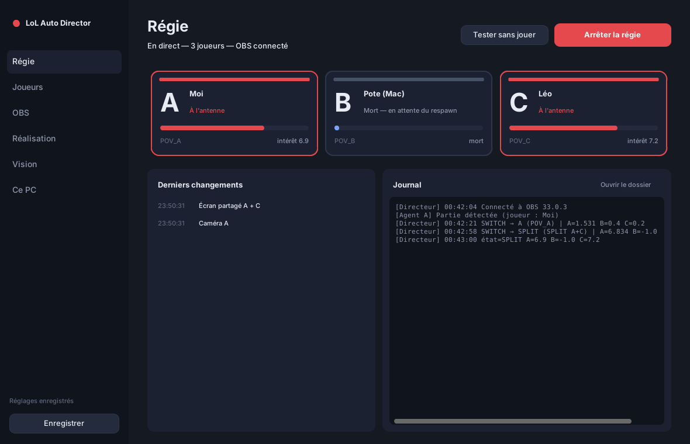
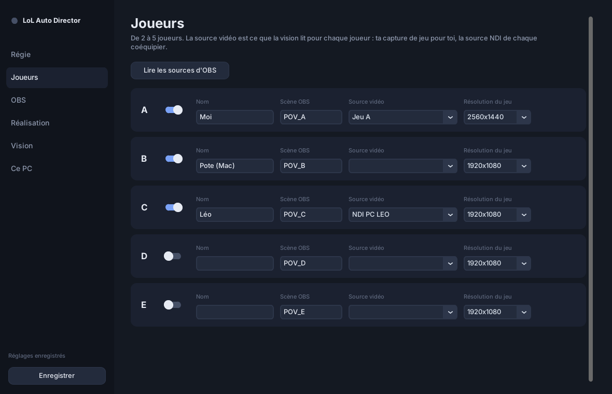

# LoL Auto Director

An automatic OBS director for League of Legends streams with 2 to 5 players on the same local network.
The stream cuts on its own to the player where something is happening, and splits the screen when two
players are in two different fights at once.



- **No manual switching.** Each player's PC sends a live "interest" score (health lost, kills, objectives,
  deaths), and the director cuts to the best POV with sensible minimum hold times.
- **Sees fights coming.** The director reads each player's minimap in OBS and raises a player's score
  when enemies gather around them, so the camera can arrive *before* the fight starts.
- **Split screen when it makes sense.** Two players fighting in two different places are shown side by
  side. Two players in the same fight get a single POV.
- **One app for everything.** Settings, OBS scene setup, a live camera wall and a log, in one window.
  You can still take over in OBS at any time: the director steps back for 20 seconds.

> The app's interface is in French. This guide gives each French label with its meaning.

## How it works

```
 Player PCs B–E (Windows or Mac)                Streaming PC (player A)
 ┌───────────────────────────┐                ┌───────────────────────────────────────────────┐
 │ League of Legends         │                │ League of Legends                             │
 │ OBS ──NDI video───────────┼──── LAN ──────►│ OBS: POV_A … POV_E + SPLIT ─────────► Twitch  │
 │ agent ──UDP score─────────┼───────────────►│ director ──WebSocket──► OBS                   │
 └───────────────────────────┘                │   └─ vision: reads the minimaps in OBS        │
                                              │ agent A ──local UDP──► director               │
                                              └───────────────────────────────────────────────┘
```

- The **agent** runs on every gaming PC. It reads the game's local Live Client Data API (the same data the
  client already exposes, nothing else) and sends a score a few times per second.
- The **director** runs on the streaming PC. It compares the scores, adds what the minimap vision sees, and
  switches the OBS scene through obs-websocket.
- Teammates' screens reach the streaming PC as **NDI** sources (OBS plugin DistroAV).

## Get started

### What you need

- **Streaming PC:** Windows 10/11 and [OBS Studio](https://obsproject.com) 28 or later.
- **Each other player:** a Windows PC or a Mac on the same network, with OBS and the
  [DistroAV](https://github.com/DistroAV/DistroAV) plugin to send their screen. Use wired Ethernet.
- A gigabit network from 3 players up (each remote player sends about 100–150 Mbit/s).

### 1. Set up the streaming PC

1. Download **`LoLAutoDirector.exe`** from the [latest release](https://github.com/vaylonn/LolAutoDirector/releases/latest) and put it in its own
   folder (it saves its settings and logs next to itself).
   Windows SmartScreen may warn about an unknown publisher: *More info › Run anyway*.
2. In OBS: *Tools › WebSocket Server Settings* › enable it, port 4455, and set a password.
3. Install DistroAV in OBS if teammates will send their screen over the network.
4. Open the app and go through the pages on the left:

   | Page | What to do |
   |---|---|
   | **Ce PC** (this PC) | Choose *PC qui diffuse* (streaming PC) and player **A**. Click *Utiliser l'IP de ce PC* (use this PC's IP) and *Nouveau jeton* (new token). |
   | **Joueurs** (players) | Turn on one card per player, give a name and the game resolution. *Source vidéo*: your game capture for you, each teammate's NDI source for them. *Lire les sources d'OBS* fills the list. |
   | **OBS** | Enter the WebSocket password, click *Tester la connexion* (test connection), then *Préparer les scènes* (create one `POV_x` scene per player, plus `SPLIT`). |
   | **Réalisation** (directing) | Optional: minimum time per POV, how reactive the cuts are, split-screen mode. |

5. Click **Enregistrer** (save), then send the `config.toml` file created next to the exe to every teammate.
6. Allow UDP port 5005 in the Windows firewall (PowerShell as administrator):

   ```powershell
   New-NetFirewallRule -DisplayName "LoL Auto Director" -Direction Inbound -Protocol UDP -LocalPort 5005 -Action Allow
   ```

To check the install without playing, open **Régie** and click *Tester sans jouer* (test without playing):
a one-minute simulated game with two fake players runs the full pipeline and prints every camera decision
in the log (OBS is not touched).

### 2. Set up each teammate

- **Windows:** [docs/player-windows.md](docs/player-windows.md). Same exe, *PC joueur* (player PC) role.
- **Mac:** [docs/player-mac.md](docs/player-mac.md). Two double-click scripts.

### 3. Go live

1. Every teammate starts their agent (*Démarrer la régie* in the app, or `mac/start.command`).
2. On the streaming PC, page **Régie** › **Démarrer la régie** (start).
3. Launch the game. Each camera tile turns green when its player is in game and red when on air.

Use the [live checklist](docs/live-checklist.md) before each stream.



## How the camera decides

Each agent scores its player about three times per second:

| Signal | Effect |
|---|---|
| Health lost in the last 3 seconds | high score: a fight is on |
| Low health | medium score |
| Kill, assist, objective, tower | bonus that fades over 6 s |
| Death | shown for 3 s, then the camera moves to the best living player |
| Role (jungle, support) | small base bonus |
| Upcoming dragon or baron | bonus for the roles involved, before it spawns |
| Vision: more enemies nearby than usual | +1.2 per extra enemy (your lane opponent does not count) |
| Vision: an enemy is closing in | +0.8, so the camera can arrive before contact |

The director then follows a few rules:

- It cuts to the highest score, staying at least 5 s on a POV (2 s if the gap is huge or the shown player died).
- **Split screen** shows the two best players when both are in action **in two different fights**. Same fight
  means a shared kill or objective in the last 10 s, or cameras close together on the minimap.
  From 3 players up, one dynamic `SPLIT` scene holds every pair; the director turns on the right two halves.
- Switch scenes yourself in OBS and the director pauses for 20 s. Show a scene it does not manage (BRB,
  intro…) and it waits until you come back.

### Minimap vision

The director grabs each player's video from OBS four times per second and reads the minimap. It finds champion
icons by their red or blue ring, and recognises the enemy champions from their official portraits
(downloaded from Riot's Data Dragon). On real footage it found 21 of 23 enemies with no false alarm, in about
20 ms per image.

The minimap area is calibrated for 16:9. For another aspect ratio, use *Vision › Calibrer*: it saves annotated
captures in `logs/vision/` so you can adjust the area.

## Settings

Everything is set in the app, which writes `config.toml`. The file is the same on every PC; each PC's role
and letter are kept separately in `ce_pc.json`. You can also edit `config.toml` by hand: see the commented
[config.example.toml](config.example.toml). Unknown keys are rejected at start-up, so typos never go unnoticed.

| I want… | Change |
|---|---|
| Fewer cuts | *Réalisation*: raise the minimum time per POV (e.g. 8 s) |
| Faster cuts | *Réalisation*: lower the minimum time and the urgent-switch lead |
| Split screen even in a shared fight | *Réalisation*: split mode *Toujours* (always) |
| No split screen | *Réalisation*: turn split screen off |
| Lighter vision | *Vision*: read every 0.5 s |
| Favour a role, kills or objectives | `[scoring]` in `config.toml` |

## Troubleshooting

| Symptom | Likely cause |
|---|---|
| *OBS injoignable* (OBS unreachable) | WebSocket off, wrong port or password. Use *OBS › Tester la connexion*. |
| `Scène OBS introuvable` (scene not found) | Scene names differ from the settings. Click *Préparer les scènes* again. |
| The camera never goes to a player | Firewall (UDP 5005), wrong streaming-PC IP or token on their side, or their letter is off in *Joueurs*. |
| A tile never turns green | The game API only exists during a real game, not in replays or the lobby. |
| Vision shows black images | The game is not in focus or OBS hides the capture: *OBS › Garder les captures actives*. |
| The director stopped switching | An unmanaged scene is on air, or it is in its 20 s pause after a manual switch. |
| The exe was blocked | SmartScreen: *More info › Run anyway* (the exe is not signed). |

Logs are in the `logs/` folder next to the exe (*Ouvrir le dossier* on the Régie page).

## Run from source

Python 3.9+ on Windows, macOS or Linux.

```bash
python -m venv .venv
.venv/bin/pip install -r requirements.txt     # Windows: .venv\Scripts\pip
.venv/bin/python -m lolauto                    # opens the app
```

On Windows, `windows/install.bat` and `windows/start.bat` do the same in two double-clicks, and
`windows/build_exe.bat` builds `LoLAutoDirector.exe`.

Every part is also available on the command line (`python -m lolauto <command>`, or `LoLAutoDirector.exe <command>`):

| Command | What it does |
|---|---|
| *(none)* or `gui` | opens the app |
| `director [-v] [--dry-run]` | runs the director (streaming PC) |
| `agent --id A..E` | runs a player's agent (`--once` checks the current game and exits) |
| `simulate` | full simulated game, no game or OBS needed (about 1 minute) |
| `obs-setup [--split]` | creates the OBS scenes |
| `vision-debug` | saves annotated minimap captures for calibration |

## Limits

- The game API gives no positions. Without the vision, the director reacts when a fight starts instead of
  anticipating it.
- Five players means four NDI streams (about 500 Mbit/s) and five minimaps to read: use wired gigabit and a
  solid streaming PC.
- The vision can miss overlapping icons. Ally detection is not used.
- For ranked games, add a **stream delay** in OBS to avoid stream sniping. The project only reads what the game
  client already exposes locally and never shows it to players.

## License

[MIT](LICENSE). Not endorsed by Riot Games. League of Legends is a trademark of Riot Games, Inc.
